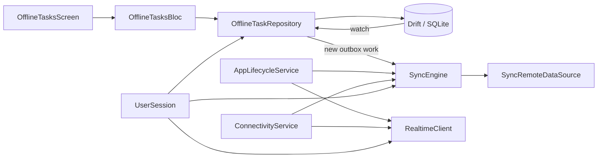

# Architecture

Product code is feature-first under `lib/features`. Application composition,
configuration, DI, and routing live in `lib/app`; reusable infrastructure lives
in `lib/core`. Presentation uses BLoC and interfaces, repositories own data and
RxDart pipelines, and GetIt is restricted to composition boundaries.

Bootstrap initializes localization, typed compile-time configuration, plugin
storage, DI, restored settings, and session before `runApp`, preventing a saved
theme flash. Singleton infrastructure owns long-lived streams; BLoCs and
screen-specific search repositories are factories and dispose deterministically.

Add a feature by following `example_search`: define the narrow data boundary,
implement a runnable source, register its construction in DI, build a BLoC, and
add a named route. Tests should inject memory sources and never initialize real
plugins or networks.

## Long-lived ownership

`AppDatabase`, `ConnectivityService`, `AppLifecycleService`, `SyncEngine`, and
`RealtimeClient` are process-lifetime lazy singletons composed in `lib/app/di`.
Bootstrap explicitly opens the database, starts lifecycle/connectivity, and
then starts sync/realtime after `UserSession` restoration. Dependency teardown
closes timers, subscriptions, sockets, subjects, and the database in that order.

The offline task UI receives a BLoC. The BLoC consumes domain models and
read-only service streams; it never imports Drift, Dio, token storage, or socket
types. `DriftOfflineTaskRepository` owns task/outbox transactions, while
`DriftSyncStore` is the persistence boundary consumed by `SyncEngine`.

Application backends replace `SyncRemoteDataSource` and, if their protocol
differs, `WebSocketTransport`/message routing. Database/domain/UI boundaries do
not change.

`disposeDependencies` tears down realtime, sync, connectivity, lifecycle,
links, notifications, feature flags, database and session in dependency order.
Router and user-data coordinators are application-runtime owners created by
bootstrap and live until process shutdown. Screens own their BLoCs/controllers.
Public extension points and internal adapters are classified in `PUBLIC_API.md`.
