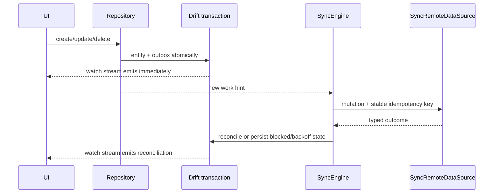

# Offline-first example

The local database is the only UI source of truth.

Commands return typed `Result` after local acceptance, not after the network. A
delete disappears immediately but remains a tombstone until confirmed. An
unattempted, unleased, unblocked create/update may absorb a rapid edit while
retaining its idempotency key. Attempted operations and kind changes are never
coalesced.

Validation and version conflicts persist a blocked reason, update item status,
and never loop. The demo exposes retry-local and discard/use-server-version
entry points. Real products must choose server wins, permitted client wins,
manual review, or domain-specific merge; universal last-write-wins is not
assumed.

The default cache policy deletes demo rows on logout/user switch. Reads always
include the authenticated owner predicate, so cleanup latency cannot expose
another user's data.
