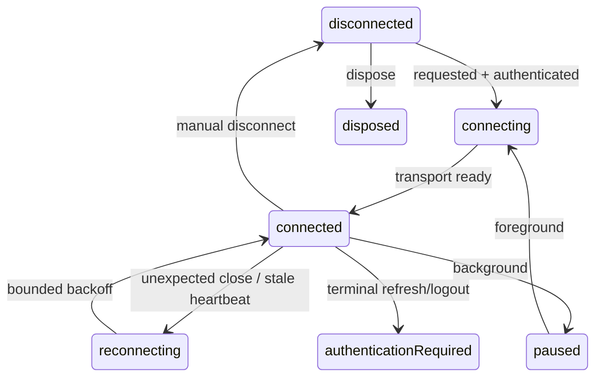

# Realtime

The layers are `WebSocketTransport → RealtimeClient → typed parser → consumer`.
Android/iOS staging/production use `IOWebSocketChannel` with an authorization
header; development injects a fake transport. `AppConfig.realtimeUrl` converts
HTTP(S) configuration to WS(S) and resolves `REALTIME_PATH` (default `/ws`).
Tokens are never placed in URLs or logs.



The state stream replays; the message stream does not. Application pings detect
stale connections, stable connections reset backoff, and disposal cancels every
timer/subscription/socket. Manual disconnect never reconnects. Authentication
expiry receives one single-flight refresh/reconnect attempt.

Envelopes contain version, type, ID, UTC timestamp, and validated payload.
Malformed frames are ignored; unknown types are logged without payload and
exposed as typed unknown events. A bounded 100-ID cache suppresses duplicates.
Only transport arrival order is preserved; cross-connection/global ordering
must use server versions or sequence numbers.

```bash
flutter test test/v03_realtime_test.dart
```
